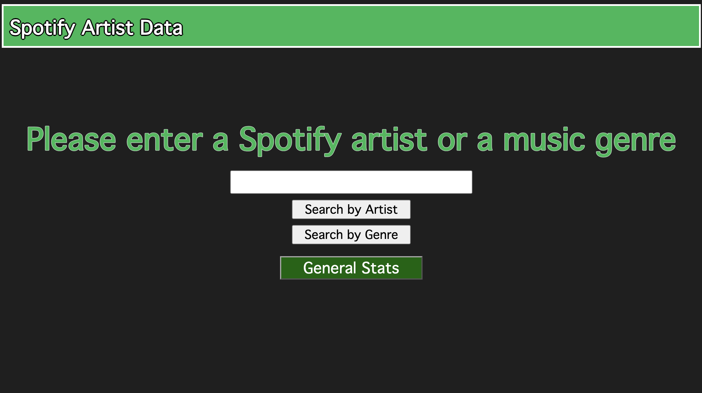
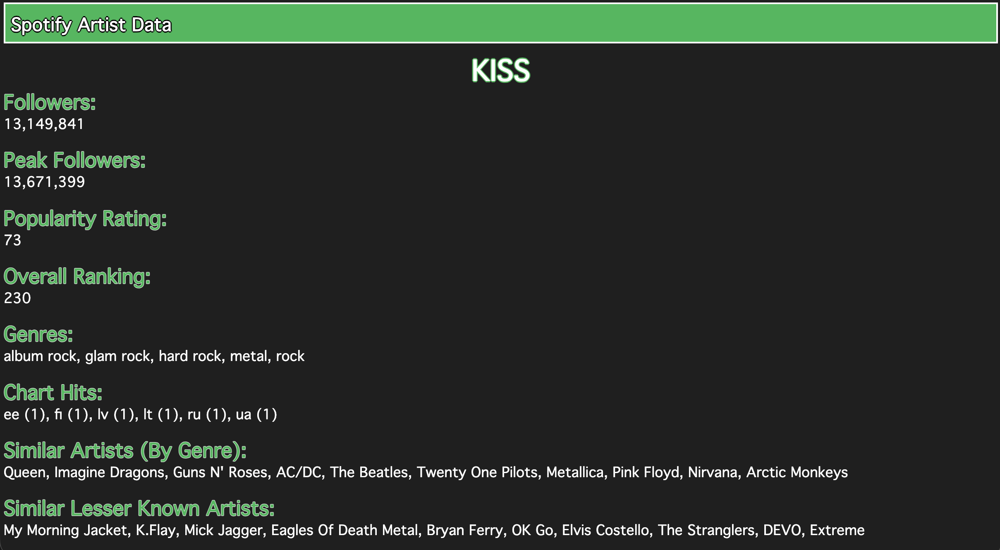
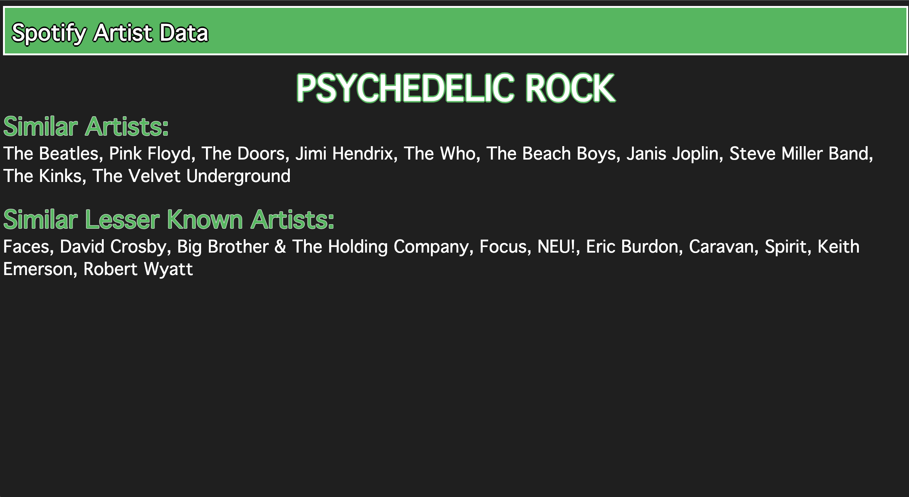

## Description
This is a flask app that lets the user search up Spotify Artists or music genres to find basic information that is taken from two public datasets. There is also the option to view general information about top artists on the platform. 

## How to install dependencies
Every package used is included within Anaconda except for flask. Can download Anaconda here: https://www.anaconda.com/download, just need to skip the registration, and then pick the correct version for your operating system. 
Flask can be installed easily after anaconda is installed by opening the 'Terminal' app in Mac or the 'Anaconda Prompt' in Windows, and then typing 'conda install flask'.

## How to use
In the terminal, navigate to the folder for the project by typing 'cd' and then the file directory for the folder. Next, type 'python app.py' to run the project. There will then be a response showing the url where the app is running, copy that url and paste into a web browser like Chrome. 

Once in the Webapp, you'll be met with a homepage with a couple different options.

  

You can search up any Spotify Artist or genre. Any artist included in the datsets will show up as a suggestion. **Artist names are case sensitive, and genre labels are in lowercase**. If you would like to search an artist, click the 'Search by Artist' button, and for a genre click the 'Search by Genre' button. In both cases some stats will appear following the artist or genre you entered. 

   
   
  <strong>Stats for the artist KISS</strong>
    
  
   
  <strong>Stats for the genre psychedelic rock</strong>

You can also click the 'General Stats' button, which will show basic data for the top 100 artists, and a series of plots for larger subsets. 
